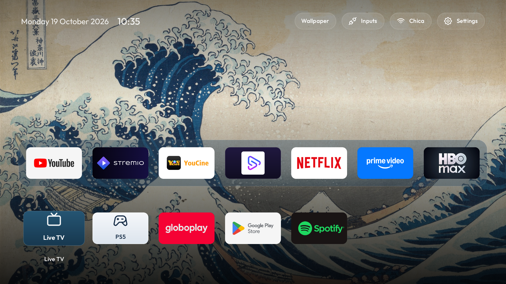
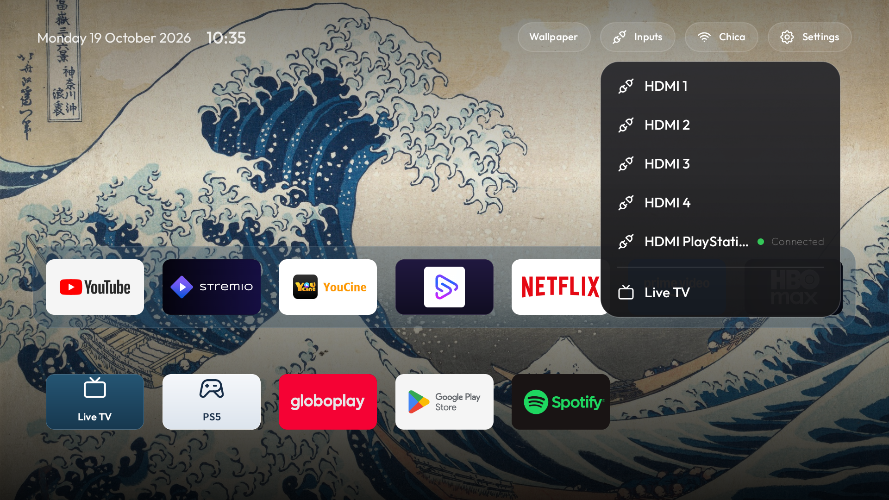

# TV Vibe Hack

A clean home screen for Android TV and Google TV. This repo contains the launcher, setup scripts,
and the configuration we tested on a **TCL C6K (G08), Android 14**.

## The TV after setup

These are screenshots captured from the configured TV. The launcher interface is in English.

| Home screen | App grid |
|---|---|
|  |  |

The dock contains YouTube, Stremio, YouCine, SportzX, Netflix, Prime Video, and HBO Max. The next
row includes Globoplay, Play Store, Live TV, and the PS5 HDMI input when connected. The **Inputs**
menu switches HDMI sources and opens Live TV:



The launcher has a selectable artwork background, clock, network and settings shortcuts, and
remote-control navigation. Choose a bundled painting or include your own image in the install
command below. A custom image is sent to the TV inside the APK and selected on first launch. The
launcher keeps the selected app focused when Android refreshes the available TV inputs. Streaming
apps remain installed. On this TCL, setup disables the original Google TV launcher and its setup
assistant so the new home screen opens with the Home button. Both can be restored.

## Install on the tested TCL C6K

1. Clone this repo to a computer on the same network as the TV:

   ```bash
   git clone https://github.com/tqchagas/tv-vibehack.git
   cd tv-vibehack
   ```

2. On the TV, enable Developer options and network ADB. Find its IP in Network settings, keep it
   on, and accept the ADB authorization prompt if it appears.
3. Install Python 3.13, JDK 17, and the Android SDK. The launcher needs SDK platform 34 and
   build-tools 34.0.0; if needed, add them with
   `sdkmanager "platforms;android-34" "build-tools;34.0.0"`.
4. Optional: put a JPG, PNG, or WebP wallpaper file on the computer. `TV_WALLPAPER` below is the
   path on the computer; the installer transfers it to the TV over ADB.

Then, from the repository directory:

```bash
python3.13 -m venv tools/venv
tools/venv/bin/python -m pip install -r tools/requirements.txt

export TV_HOST="192.168.1.50"       # replace with the TV's IP
export JAVA_HOME="/path/to/jdk-17"
export ANDROID_HOME="/path/to/android-sdk"
# Optional: uncomment and replace with an image path on this computer
# export TV_WALLPAPER="/absolute/path/to/my-wallpaper.jpg"
bash examples/tcl-c6k/install.sh
```

On a fresh install, leaving out `TV_WALLPAPER` uses the bundled Hokusai wallpaper. With it set,
the installer puts your image in the app before building, transfers it over ADB, and selects it
automatically. The Wallpaper menu will also let you switch between your image and the included
paintings. To change it later, set `TV_WALLPAPER` to a different file and run the install command
again.

The script builds the launcher, installs it, sets it as Home, and verifies the change. It is
configured for the tested TCL firmware; **do not use this TCL installer on another TV**. For a
different Android TV or Google TV, start with [PROMPT.md](PROMPT.md) and adapt the model-specific
package settings first. Samsung Tizen, LG webOS, and Fire TV are not supported by this Android
launcher.

## Restore the original Google TV home

Run this from the repository directory, using the same TV IP:

```bash
TV_HOST="192.168.1.50" bash examples/tcl-c6k/restore.sh
```

This re-enables the original launcher and setup assistant, and returns the Home button to Google
TV. The custom launcher stays installed.

## Talking to the TV by hand

Set up the Python ADB client once, then point it at the TV's IP. On the TCL C6K, enable Developer
options and network ADB first, and accept the authorization prompt on the TV:

```bash
python3.13 -m venv tools/venv
tools/venv/bin/python -m pip install -r tools/requirements.txt
export TV_HOST="192.168.1.50"       # replace with the TV's IP
tools/venv/bin/python -I tools/tv.py --probe
tools/venv/bin/python -I tools/tv.py 'pm list packages'
```

For the **TCL C6K (G08)**, use the model-specific scripts to install or restore the launcher:

```bash
export JAVA_HOME="/path/to/jdk-17"
export ANDROID_HOME="/path/to/android-sdk"
bash examples/tcl-c6k/install.sh
bash examples/tcl-c6k/restore.sh
```

For the **Xiaomi Mi TV 4A**, the example currently contains a debloat list:

```bash
tools/disable.sh examples/xiaomi-mi-tv-4a/debloat.txt
tools/restore.sh examples/xiaomi-mi-tv-4a/debloat.txt
```

## Customize

- Change dock order, hidden app tiles, Live TV, or grid columns in
  [`launcher/app/src/main/res/values/config.xml`](launcher/app/src/main/res/values/config.xml).
- Choose a personal image in the launcher's **Wallpaper** menu, or change the bundled artwork.
  Image credits are in
  [`launcher/WALLPAPER-CREDITS.md`](launcher/WALLPAPER-CREDITS.md).
- Rebuild and reinstall with the TCL script above.

The scripts and app code are in [`launcher/`](launcher/), the tested TCL setup is in
[`examples/tcl-c6k/`](examples/tcl-c6k/), and the assistant workflow for adapting another TV is in
[`PROMPT.md`](PROMPT.md).

## License

MIT. See [LICENSE](LICENSE). The Outfit typeface uses the SIL Open Font License.
